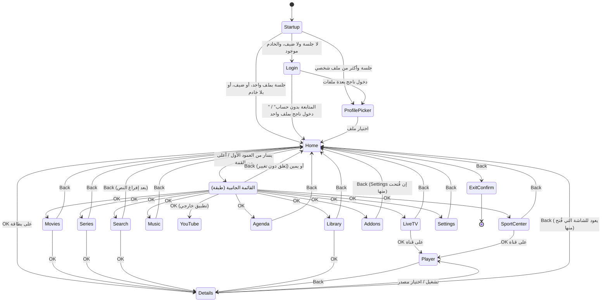

# QR TIME — مواصفات الواجهة والتنقل

الحالة: **التصميم معتمد للتنفيذ، والتنفيذ تدريجي.** كل شاشة وكل زر في هذه الوثيقة له سلوك محدد.
وإذا لم تكتمل وحدة ما بعد، يُذكر سلوكها المؤقت الحقيقي صراحةً، ولا يوجد زر زخرفي.

مفتاح الحالة في الجداول:
- ✅ موجود ويعمل.
- 🆕 بُني في هذه الخطوة.
- ⏳ مؤقت: سلوك حقيقي محدود إلى أن تكتمل الوحدة.
- 📋 مخطط في خطوة لاحقة، وغير ظاهر في الواجهة.

---

## 1. بنية الواجهة (UI architecture)

```
main.c   ── حلقة الأحداث، الريموت (remapCanal)، دورة حياة webOS
  │
app.c    ── الموجّه (router): شاشة حالية واحدة (Tela) + طبقات فوقها
  │          ├─ تبديل الشاشة: trocarTela(نوع) — كل شاشة تبدأ بحالة نظيفة
  │          ├─ الرجوع: كل شاشة تعلن x_quer_sair() والموجّه يقرر الوجهة
  │          └─ الطلبات: x_pediu_*() تُقرأ مرة واحدة كل إطار (لا callbacks)
  │
menu.c   ── القائمة الجانبية: طبقة فوق الشاشة، تملك الـ D-pad وهي مفتوحة
  │
الشاشات  ── home · guia · busca · biblioteca · agendaui · ajustes · addonsui · perfil
الطبقات  ── detail (صفحة العنوان) · vertudo (الشبكة) · player · spotlight · ctxmenu
  │
UI kit   ── gfx (رسم GLES2، زجاج، ثقب الفيديو) · text (خطوط + i18n + bidi)
             tex_cache (ميزانية الصور) · focus/anim (مرونة التركيز) · ponteiro (Magic Remote)
```

**القواعد:**
1. **عقد الشاشة.** كل شاشة توفّر `x_iniciar / x_evento / x_atualizar / x_desenhar / x_quer_sair`.
   الشاشة لا تعرف الشاشات الأخرى؛ تطلب، والموجّه ينفّذ.
2. **ممنوع حجب الرسم بالشبكة.** البيانات تأتي من خيوط (`RedeJob`) وتُنشر في `*_passo()` على خيط الرسم.
3. **الطبقات.** صفحة العنوان والشبكة تُفتحان فوق الشاشة الحالية، فيبقى التركيز تحتها محفوظًا عند الرجوع.
4. **الهوية الموحدة للمحتوى.** فيلم واحد يظهر بطاقة واحدة (المفتاح IMDb/TMDB)، وصفحة العنوان تجمع كل
   المصادر في قائمة واحدة (`streams.c`). مصادر IPTV VOD تُضاف بالمرحلة 2 عبر `ProviderRef`
   (انظر ARCHITECTURE-PLAN.md §3.1).

---

## 2. مخطط حالات التنقل



**قاعدة الرجوع:** Back يتراجع داخل الشاشة أولًا: يغلق لوحة، أو يفرغ نصًا، أو يرجع من الشبكة.
بعدها يرجع إلى الشاشة الرئيسية. في الشاشة الرئيسية يطلب الخروج من التطبيق.

---

## 3. جرد الشاشات

### 3.1 القائمة الرئيسية (بالترتيب المطلوب)

| # | الوجهة | الشاشة / السلوك | الحالة | المصدر |
|---|---|---|---|---|
| 1 | الرئيسية | `TELA_HOME` | ✅ | `home.c` |
| 2 | البث المباشر | `TELA_GUIA`: دليل القنوات من كل مزوّدي IPTV والإضافات | ✅ | `guia.c` |
| 3 | أفلام | شبكة تجمع كل كتالوجات **الأفلام** النشطة من كل الإضافات، تبويب لكل كتالوج. إذا لم يوجد كتالوج: إشعار "لا توجد إضافة مفعّلة تنشر هذا النوع من الكتالوجات" | 🆕 | `vertudo.c` + `app.c` (`navAbrirTipo`) |
| 4 | مسلسلات | مثلها لكتالوجات **المسلسلات** | 🆕 | `vertudo.c` + `app.c` |
| 5 | Sport Center | ⏳ يفتح دليل القنوات مركّزًا على أول قسم اسمه يحوي كلمة رياضية (sport، esporte، deporte، football، رياض…) من أي مزوّد. إن لم يوجد: إشعار "لا يوجد قسم رياضة في قوائم البث المباشر لديك". الوحدة الكاملة (نتائج ومباريات ومطابقة القنوات) بالمرحلة 4 | ⏳ | `guia.c` (`guia_focar_secao`) |
| 6 | الموسيقى | 📋 **مخفية من القائمة إلى أن يُبنى مركز الموسيقى (المرحلة 7).** الموسيقى المحفوظة الحالية تحتاج حساب Nuvio وخادم التوصيات (`NV_REC_URL`)، فإظهارها للضيف سيعطي زرًا بلا نتيجة. التفعيل: `-DQRT_MUSICA_PRONTA` | 📋 | `menu.c` |
| 7 | YouTube | يفتح تطبيق YouTube الرسمي على التلفاز (`youtube.leanback.v4`). البحث داخل QR TIME بالمرحلة 6 | 🆕 | `ondever.c` |
| 8 | الأجندة | `TELA_AGENDA` | ✅ | `agendaui.c` |
| 9 | البحث | `TELA_BUSCA`؛ ضغط OK مطوّلًا يفتح Spotlight | ✅ | `busca.c` |
| 10 | الإضافات والمزوّدون | `TELA_ADDONS` (تثبيت، ترتيب، تفعيل) | ✅ (الوصول من القائمة 🆕) | `addonsui.c` |
| 11 | المفضلة / مكتبتي | `TELA_BIBLIOTECA` | ✅ | `biblioteca.c` |
| 12 | الإعدادات | `TELA_AJUSTES` | ✅ | `ajustes.c` |
| — | الملف الشخصي | في أسفل القائمة (الصورة الرمزية) | ✅ | `menu.c` |
| — | استكشاف / الإحصاءات | وجهتان قديمتان، مخفيتان افتراضيًا ويمكن إظهارهما من الإعدادات | ✅ | — |

### 3.2 صفوف الشاشة الرئيسية

| الصف المطلوب | الحالة | الملاحظة |
|---|---|---|
| البطل المميز (hero) | ✅ | `home.c` + `fil_hero_fonte` |
| متابعة المشاهدة | ✅ | `continue_watching` (محلي + Trakt) |
| آخر المشاهدات | 📋 الخطوة 3 | من `progresso.c` / `visto.c` |
| أفلام ومسلسلات موصى بها | ✅ جزئيًا | صفوف كتالوجات الإضافات؛ توصيات TMDB بالخطوة 3 |
| الرائج | ✅ عند توفر كتالوج رائج من الإضافات | TMDB trending بالخطوة 3 |
| القنوات المفضلة / الأخيرة | 📋 الخطوة 3 | من `guia_e_favorito` + سجل القنوات |
| مباريات Sport Center | 📋 المرحلة 4 | |
| الموسيقى | 📋 المرحلة 7 | |
| صفوف الإضافات والمزوّدين | ✅ | كتالوجات + مجموعات |

### 3.3 الشاشات الأخرى

| الشاشة | الحالة |
|---|---|
| صفحة العنوان (كل المصادر في قائمة واحدة) | ✅ لمصادر الإضافات؛ IPTV VOD بالمرحلة 2 |
| المشغّل (أفلام) والمشغّل المباشر (OSD القنوات) | ✅ |
| البحث الموحد (أفلام، مسلسلات، كتالوجات) | ✅؛ القنوات والموسيقى والرياضة بالخطوة 4 |
| شاشة الدخول (مع "المتابعة بدون حساب") | ✅ |
| اختيار الملف الشخصي | ✅ |

---

## 4. التركيز والريموت

### 4.1 مفاتيح عامة

| المفتاح | السلوك |
|---|---|
| الأسهم | تحريك التركيز بلا التفاف في أطراف القوائم. الصفوف الأفقية تتذكر العمود لكل صف |
| OK | تنفيذ العنصر المركّز. الضغط المطوّل على "البحث" يفتح Spotlight، وعلى بطاقة يفتح قائمة السياق |
| Back | تراجع داخل الشاشة أولًا، ثم إلى الرئيسية، ثم طلب الخروج (§2) |
| يسار من العمود الأول | يفتح القائمة الجانبية فوق الشاشة دون فقد التركيز تحتها |
| CH+ / CH- | تبديل القناة أثناء البث المباشر |
| الأحمر / الأخضر / الأصفر / الأزرق | كما في `main.c` (البحث، الدليل، …) دون تغيير في هذه الخطوة |
| Magic Remote | كل عنصر قابل للتركيز له هدف مؤشر (`ponteiro_alvo`). المرور يركّز، والنقر = OK |

### 4.2 القائمة الجانبية

- تُفتح والتمييز على **الوجهة الحالية**، لا على آخر موضع.
- أعلى/أسفل تتنقلان بين الوجهات **الظاهرة** فقط، وبعد الأخيرة تأتي الصورة الرمزية للملف الشخصي.
- OK أو يمين يختار. Back يُغلق دون تغيير.
- الاختيار يغلق أي طبقة مفتوحة (صفحة عنوان أو شبكة) قبل الانتقال.
- **تخطيط "القائمة في الأعلى" (اختياري):** إذا كانت العناوين ستُقطع، أو كان الشريط سيتجاوز 1250 px
  فيزحم الصورة الرمزية والساعة، تتحول كل العناصر إلى أيقونات مربعة. لا يُقطع عنوان أبدًا.
  ([صورة](shots/nav-topo.png)) القائمة الجانبية (الافتراضية) تعرض العناوين كاملة دائمًا.
  تحسين لاحق: إظهار اسم العنصر المركّز في وضع الأيقونات.

### 4.3 حالات التركيز (بصريًا)

| الحالة | العرض |
|---|---|
| مُركَّز | تكبير البطاقة `NV_FOCUS_ESCALA` (‎+9%‎)، وإطار، وتعبئة فاتحة للأزرار. مرونة `NV_MOLA_FOCO` (95% في 120 ms) |
| محدد / الوجهة الحالية | خط تأشير في القائمة الجانبية |
| غير نشط | شفافية `NV_MENU_INATIVO` (0.72) |
| تحميل | هيكل رمادي (`NV_COR_ESQUELETO`) بدل الصورة، والنص يظهر فورًا |
| صورة مفقودة | بطاقة نصية بعنوان العمل (`artefalta.h`)، ولا تبقى بطاقة فارغة |

---

## 5. Design tokens والمكونات

### 5.1 Tokens (قيم حقيقية من الكود)

| المجموعة | القيمة | الموضع |
|---|---|---|
| لوحة الرسم | 1920×1080 مع تحجيم (720p و4K) | `NV_TELA_BASE_W/H` |
| الهوامش | X = 80، Y = 60 | `NV_MARGEM_X/Y` |
| الزوايا | بطاقة 0.055، حبة 0.5، شارة 0.18 من الارتفاع | `NV_RAIO_*` |
| التركيز | تكبير 0.09، مرونة 25 | `NV_FOCO_ESCALA`, `NV_MOLA_FOCO` |
| الألوان | خلفية حية (تتبع لون التمييز)، ولون تركيز، وهيكل التحميل | `NV_COR_*` |
| النصوص | TITULO1..3، HEADLINE، BODY، CALLOUT، CAPTION، MINI + أنماط خاصة (HERO، DET، ILHA) | `text.h` |
| الحركة | فتح القائمة 230 ms وإغلاقها 150 ms؛ "تقليل الحركة" يلغي النوابض | `NV_MENU_*_MS` |
| الخطوط | Inter Display، Montserrat، Roboto؛ Noto Naskh للعربية؛ DroidSans للصينية واليابانية | `deploy/app/fonts` |

هوية QR TIME البصرية (الشعار، ولون التمييز الأساسي، والأيقونات) بالمرحلة 8. الـ tokens أعلاه هي
النظام الذي ستُبنى عليه، ولن يُستبدل.

### 5.2 المكونات القابلة لإعادة الاستخدام

| المكون | الدالة |
|---|---|
| زر حبّة | `gfx_vidro_pilula_cheia` + نص مركزي (الدخول، الضيف، الشاشة الفارغة) |
| لوحة زجاجية | `gfx_vidro_material` |
| بطاقة عمل | `home.c` / `vertudo.c` (ملصق 2:3، أفقي 16:9، مربع) + شارات (`badges.c`) |
| صف أفقي | `fileiras.c` (تخطيطات: ملصق، مميز، Top 10، …) |
| شبكة | `vertudo.c` (تبويبات مصادر + تخطيطات) |
| أيقونة | `gfx_icone(اسم)` من `art/icones/*.png` (خط Lucide) |
| هدف المؤشر | `ponteiro_alvo` |

---

## 6. التنفيذ في هذه الخطوة

انظر الجدول §3.1. التنفيذ: الوجهات الـ 12 بالترتيب المطلوب، وشاشتا الأفلام والمسلسلات، والسلوك المؤقت
الحقيقي لـ Sport Center والموسيقى، وتشغيل YouTube، والوصول المباشر إلى الإضافات.

## 6.1 فجوات اكتُشفت أثناء التنفيذ

1. **لا يستطيع الضيف إضافة أي إضافة (add-on).** شاشة الإضافات تعرض قائمة الحساب فقط مع التفعيل
   والتعطيل، ولا يوجد "تثبيت بالعنوان". لذلك تبقى شبكتا الأفلام والمسلسلات فارغتين عند الضيف.
   **هذه الأولوية التالية.** (أُزيل النص الذي كان يعِد بذلك في بطاقة الشاشة الفارغة.)
2. **العناوين بلا ملصق تُسقَط بصمت** من كتالوجات الإضافات (`descoberta.c`، `deMeta`). يتعارض هذا مع
   "التعامل مع الملصقات المفقودة"، ويحتاج بطاقة نصية بدل الإسقاط.
3. **عدة بطاقات أول تشغيل متتالية** (ما الجديد في Nuvio 2.0، تلميح زر السجل، "الحفظ بـ +"، مقدمة
   التشخيص) تظهر فوق الشاشة الرئيسية وتلتقط أول ضغطات الريموت. تُراجَع مع الهوية البصرية (المرحلة 8).

**صور من التشغيل الفعلي:** [القائمة](shots/nav-menu.png) · [الأفلام](shots/nav-movies.png) ·
[Sport Center](shots/nav-sport.png) · [القائمة في الأعلى](shots/nav-topo.png)

## 7. الاختبارات

- `tests/qrtime_nav.sh` (**25/25 نجاح**): يشغّل التطبيق الحقيقي على Xvfb كضيف، مع إضافة اختبار محلية
  (كتالوج أفلام وآخر مسلسلات على 127.0.0.1)، وضغطات ريموت حقيقية. لكل وجهة ظاهرة من الـ 13: يسار ← أسفل×N
  ← OK، ويتحقق من النتيجة في السجل (انتقال الشاشة، وفتح الشبكة بعدد كتالوجاتها، وتشغيل YouTube، وقسم الرياضة)،
  ثم Back ← الرئيسية.
  - **غير مغطى بعد:** مسار Sport Center مع قائمة IPTV فيها قسم رياضة فعلًا.
- `tests/menu_ocultos.sh` و`menu_topo.sh` و`menu_topo_tira.sh`: حُدّثت للترتيب الجديد. `menu_topo` يتحقق
  أن العناوين لا تُقطع في 5 لغات، وأن وضع الأيقونات يعمل بأزرار مربعة وعرض 660 px.
- اختبارات قائمة قديمة كانت معطّلة على Linux، أُصلحت دوالها البديلة وتعمل الآن: `menu_avatar` و`menu_tvos`
  و`sidebaratv_geometry`.
- تشغيل فعلي على Xvfb بصور لكل وجهة (`docs/qrtime/shots/nav-*.png`).
